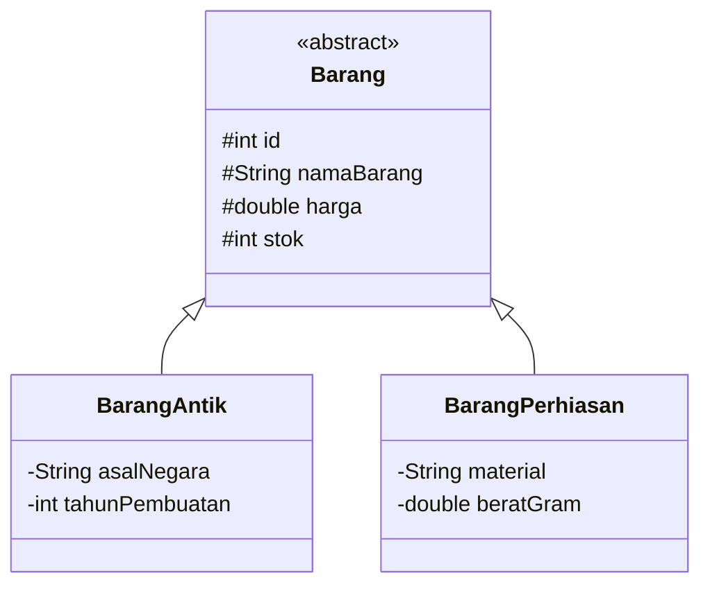

# Dokumentasi Program Mini Project 4 PBO

## Sistem Manajemen Inventaris Toko Barang Antik (Monarch Antiqu'e) — Versi Database

---

### Informasi Mahasiswa

* **Nama** : Mikhel Febian
* **NIM** : 2509116056
* **Kelas** : B
* **Angkatan** : 2025
* **Mata Kuliah** : Pemrograman Berorientasi Objek
* **Tema Program** : Sistem Manajemen Inventaris Barang Antik
* **Nama Sistem** : Monarch Antiqu'e System

---

## 1. Deskripsi Singkat Program

**Monarch Antiqu'e System** merupakan aplikasi manajemen inventaris barang antik berbasis **Command Line Interface (CLI)** yang dikembangkan menggunakan bahasa pemrograman Java.

Program digunakan untuk mengelola data barang antik dan perhiasan melalui operasi **Create, Read, Update, dan Delete (CRUD)**. Pengguna dapat menambahkan, menampilkan, mencari, memperbarui, dan menghapus data barang.

Pada **Mini Project 4**, program dikembangkan dari Mini Project 3 dengan perubahan utama:

* Penyimpanan data dipindahkan dari `ArrayList` (memori) ke **database MySQL**.
* Akses database dilakukan menggunakan **JDBC dengan `PreparedStatement`**.
* Akses data dipisahkan ke dalam lapisan **DAO (Data Access Object)**.
* Data awal (dummy data) diisi melalui **file `.sql`**, bukan melalui kode program, sehingga saat menu *Tampilkan Semua Barang* dijalankan data langsung tampil.
* Konsep OOP dari Mini Project 3 (Encapsulation, Inheritance, Polymorphism, Abstraction, Interface, dan MVC) tetap dipertahankan.

Nilai tambah: **[CEK: tulis jika ORM diterapkan, misal "Implementasi framework ORM (Hibernate) — lihat Bagian 11". Hapus kalimat ini jika tidak diterapkan.]**

---

## 2. Spesifikasi Program

* **Bahasa Pemrograman** : Java
* **JDK** : JDK 17+
* **IDE** : Apache NetBeans
* **Build Tool** : Maven
* **Database** : MySQL **[CEK: sesuaikan jika memakai MariaDB/PostgreSQL]**
* **Koneksi Database** : JDBC (MySQL Connector/J) dengan `PreparedStatement`
* **Pola Akses Data** : DAO (Data Access Object)
* **Arsitektur** : Model-View-Controller (MVC)
* **Antarmuka** : Command Line Interface (CLI)

---

## 3. Struktur Package

```text
Minpro-4-PBO-ManajemenTokoAntik
├── database/
│   └── toko_antik.sql                  <- skema tabel + dummy data awal
├── src/main/java/com/mycompany/tokoantik
│   ├── config/
│   │   └── DatabaseConnection.java     <- pengelola koneksi JDBC
│   ├── controller/
│   │   └── BarangController.java
│   ├── dao/
│   │   ├── BarangDAO.java              <- interface DAO
│   │   └── BarangDAOImpl.java          <- implementasi JDBC (PreparedStatement)
│   ├── model/
│   │   ├── Authenticable.java
│   │   ├── Barang.java
│   │   ├── BarangAntik.java
│   │   └── BarangPerhiasan.java
│   ├── util/
│   │   └── Validator.java
│   ├── view/
│   │   └── MainView.java
│   └── Main.java
├── pom.xml
└── README.md
```

> **[CEK: sesuaikan nama package/file di atas dengan struktur asli di project, terutama nama file `.sql`, letak `DatabaseConnection`, dan nama class DAO.]**

### Fungsi setiap package

| Package / File | Fungsi                                                                 |
| -------------- | ---------------------------------------------------------------------- |
| `model`        | Menyimpan class entitas dan kontrak interface                          |
| `dao`          | Berisi seluruh query SQL (`PreparedStatement`) untuk CRUD ke database  |
| `config`       | Mengelola pembuatan koneksi ke database                                |
| `controller`   | Menjembatani View dan DAO, serta menangani logika pengelolaan data     |
| `view`         | Menangani tampilan CLI dan interaksi dengan pengguna                   |
| `util`         | Menyediakan fungsi validasi input                                      |
| `database/*.sql` | Skema database dan data awal (dummy data)                            |
| `Main`         | Entry point program                                                    |

---

## 4. Alur Program

Saat program dijalankan, `Main` membuat objek `MainView` lalu menjalankan method `start()`. Seluruh operasi data diteruskan dari View ke Controller, kemudian ke DAO, dan berakhir di database.

```text
Main
  ↓
MainView  (input/output CLI)
  ↓
BarangController  (logika pengelolaan)
  ↓
BarangDAO  →  BarangDAOImpl  (PreparedStatement)
  ↓
DatabaseConnection  (JDBC)
  ↓
Database MySQL  (tabel barang)
```

Menu utama:

```text
1. Tambah Barang
2. Tampilkan Semua Barang
3. Cari Barang
4. Update Barang
5. Hapus Barang
6. Keluar
```

### 4.1 Tambah Barang

Pengguna memilih jenis barang (Barang Antik / Barang Perhiasan), lalu mengisi atribut umum dan atribut khusus. Controller membuat object `BarangAntik` atau `BarangPerhiasan`, kemudian DAO menjalankan `INSERT` melalui `PreparedStatement`.

### 4.2 Tampilkan Semua Barang

DAO menjalankan `SELECT` dan mengubah setiap baris hasil query (`ResultSet`) menjadi object `BarangAntik` atau `BarangPerhiasan` sesuai kolom jenis. Hasil ditampilkan dalam bentuk tabel. Karena data awal sudah ada di database (dari file `.sql`), menu ini langsung menampilkan data tanpa input terlebih dahulu.

### 4.3 Cari Barang

Pencarian dapat dilakukan berdasarkan ID (`WHERE id = ?`) atau nama/keyword (`WHERE nama_barang LIKE ?`). Controller memakai method `cariBarang()` dengan parameter berbeda (overloading).

### 4.4 Update Barang

Pengguna memasukkan ID barang. Data lama diambil dari database, ditampilkan, lalu nilai baru diterapkan melalui setter dan disimpan dengan `UPDATE`. Menekan `ENTER` tanpa input mempertahankan nilai lama.

### 4.5 Hapus Barang

Pengguna memasukkan ID dan memberi konfirmasi (`y/n`) sebelum DAO menjalankan `DELETE`.

### 4.6 Keluar

Program menghentikan perulangan menu dan mengakhiri program.

---

## 5. Penerapan Encapsulation

Encapsulation diterapkan dengan membatasi akses langsung terhadap atribut object dan menyediakan getter/setter.

```java
protected String namaBarang;
protected double harga;
protected int stok;
```

```java
public String getNamaBarang() {
    return namaBarang;
}

public void setNamaBarang(String namaBarang) {
    if (namaBarang == null || namaBarang.trim().isEmpty()) {
        throw new IllegalArgumentException("Nama barang tidak boleh kosong.");
    }
    this.namaBarang = namaBarang;
}
```

Setter menjaga agar data tetap valid (misalnya harga dan stok tidak negatif). Data yang dibaca dari database juga melewati constructor/setter yang sama, sehingga aturan validasi tetap berlaku.

---

## 6. Penerapan Inheritance

`Barang` adalah superclass, sedangkan `BarangAntik` dan `BarangPerhiasan` adalah subclass.



```java
public class BarangAntik extends Barang implements Authenticable
public class BarangPerhiasan extends Barang implements Authenticable
```

Constructor subclass memanggil constructor superclass:

```java
super(id, namaBarang, harga, stok);
```

---

## 7. Penerapan Polymorphism dan Abstraction

### 7.1 Abstraction

`Barang` adalah abstract class yang tidak dibuat langsung sebagai object.

```java
public abstract class Barang {
    public abstract String getJenisBarang();
    public abstract String getDetailAtribut();
}
```

Setiap subclass wajib mengimplementasikan kedua method tersebut. Abstraction juga diterapkan pada layer data melalui **interface `BarangDAO`** yang hanya mendefinisikan kontrak operasi CRUD, sedangkan `BarangDAOImpl` menentukan cara kerjanya dengan JDBC.

### 7.2 Polymorphism — Overriding

```java
@Override
public String getJenisBarang() { return "Perhiasan"; }

@Override
public String getDetailAtribut() {
    return String.format(
        "Mat: %-10s | Berat: %.1fg | Sertifikat: %s",
        material, beratGram, getKodeSertifikat()
    );
}
```

Data dari database disimpan dalam `List<Barang>`, dan pemanggilan `getJenisBarang()` / `getDetailAtribut()` otomatis menyesuaikan tipe object sebenarnya (`BarangAntik` atau `BarangPerhiasan`).

### 7.3 Polymorphism — Overloading

```java
public Barang tambahBarang(String nama, double harga, int stok, String asal, int tahun)
public Barang tambahBarang(String nama, double harga, int stok, String material, double berat)

public Barang cariBarang(int id)
public ArrayList<Barang> cariBarang(String keyword)
```

---

## 8. Penerapan MVC dan DAO

| Lapisan    | File                                           | Tanggung jawab                                   |
| ---------- | ---------------------------------------------- | ------------------------------------------------ |
| Model      | `Barang`, `BarangAntik`, `BarangPerhiasan`, `Authenticable` | Struktur data dan perilaku object   |
| View       | `MainView`                                     | Menu, input, dan tampilan CLI                    |
| Controller | `BarangController`                             | Menghubungkan View dengan DAO                    |
| DAO        | `BarangDAO`, `BarangDAOImpl`                   | Seluruh akses dan query ke database              |

Dengan DAO, tidak ada query SQL di `MainView` maupun `BarangController`. Seluruh SQL berada di `BarangDAOImpl`.

---

## 9. Penerapan JDBC

### 9.1 Database dan File `.sql`

File **`database/toko_antik.sql`** diupload ke repository dan berisi pembuatan database, tabel, serta **dummy data awal**. Data awal diisi lewat file `.sql` ini, **tidak diisi lewat kode Java**.

Cara menjalankan:

```bash
mysql -u root -p < database/toko_antik.sql
```

atau lewat phpMyAdmin / MySQL Workbench (menu *Import*).

Contoh isi file (sesuaikan dengan file asli):

```sql
CREATE DATABASE IF NOT EXISTS db_toko_antik;
USE db_toko_antik;

CREATE TABLE barang (
    id INT AUTO_INCREMENT PRIMARY KEY,
    jenis VARCHAR(20) NOT NULL,
    nama_barang VARCHAR(100) NOT NULL,
    harga DOUBLE NOT NULL,
    stok INT NOT NULL,
    asal_negara VARCHAR(50),
    tahun_pembuatan INT,
    material VARCHAR(50),
    berat_gram DOUBLE
);

INSERT INTO barang (jenis, nama_barang, harga, stok, asal_negara, tahun_pembuatan, material, berat_gram)
VALUES
('ANTIK', '<nama barang antik>', 0, 0, '<negara>', 1900, NULL, NULL),
('PERHIASAN', '<nama perhiasan>', 0, 0, NULL, NULL, '<material>', 0);
```

> **[CEK: ganti blok SQL di atas dengan skema dan dummy data asli dari file `.sql` kamu.]**

### 9.2 Koneksi Database

Class `DatabaseConnection` menyediakan koneksi JDBC:

```java
public class DatabaseConnection {
    private static final String URL  = "jdbc:mysql://localhost:3306/db_toko_antik";
    private static final String USER = "root";
    private static final String PASS = "";

    public static Connection getConnection() throws SQLException {
        return DriverManager.getConnection(URL, USER, PASS);
    }
}
```

Dependency JDBC driver ditambahkan pada `pom.xml` (MySQL Connector/J).

### 9.3 Prepared Statement

Seluruh query memakai `PreparedStatement` dengan parameter `?` agar aman dari SQL Injection. Contoh pada `BarangDAOImpl`:

```java
// CREATE
String sql = "INSERT INTO barang (jenis, nama_barang, harga, stok, ...) VALUES (?, ?, ?, ?, ...)";
try (Connection conn = DatabaseConnection.getConnection();
     PreparedStatement ps = conn.prepareStatement(sql)) {
    ps.setString(1, barang.getJenisBarang());
    ps.setString(2, barang.getNamaBarang());
    ps.setDouble(3, barang.getHarga());
    ps.setInt(4, barang.getStok());
    ps.executeUpdate();
}

// READ BY ID
String sql = "SELECT * FROM barang WHERE id = ?";

// SEARCH
String sql = "SELECT * FROM barang WHERE nama_barang LIKE ?";
ps.setString(1, "%" + keyword + "%");

// UPDATE
String sql = "UPDATE barang SET nama_barang = ?, harga = ?, stok = ?, ... WHERE id = ?";

// DELETE
String sql = "DELETE FROM barang WHERE id = ?";
```

| Operasi | Query                | Method DAO (contoh)  |
| ------- | -------------------- | -------------------- |
| Create  | `INSERT`             | `tambah(Barang)`     |
| Read    | `SELECT`             | `getAll()`           |
| Search  | `SELECT ... WHERE`   | `cariById()`, `cariByNama()` |
| Update  | `UPDATE`             | `update(Barang)`     |
| Delete  | `DELETE`             | `hapus(int id)`      |

> **[CEK: sesuaikan nama method DAO dengan yang ada di `BarangDAO.java`.]**

`try-with-resources` dipakai agar `Connection` dan `PreparedStatement` otomatis ditutup, dan `SQLException` ditangani dengan `try-catch`.

---

## 10. Penerapan Interface

Interface `Authenticable` tetap digunakan oleh `BarangAntik` dan `BarangPerhiasan`.

```java
public interface Authenticable {
    final String SERTIFIKAT_PREFIX = "CERT-MONARCH-";

    String getKodeSertifikat();
    boolean verifikasiKeaslian();
}
```

Implementasi verifikasi berbeda pada setiap class: `BarangAntik` memeriksa `tahunPembuatan < 1950`, sedangkan `BarangPerhiasan` memeriksa `beratGram > 0.5`.

---

## 11. Validasi dan Exception Handling

Class `Validator` pada package `util` menangani validasi input:

```java
try {
    return Integer.parseInt(input);
} catch (NumberFormatException e) {
    System.out.println("-> Input tidak valid!");
}
```

Validasi meliputi input kosong, angka negatif, pilihan menu di luar rentang, dan nilai berat tidak valid. Model melempar `IllegalArgumentException` untuk data tidak valid, dan `SQLException` dari DAO ditangani agar program tidak berhenti saat terjadi kesalahan database.

---

## 12. Dokumentasi Output Program

Berikut merupakan dokumentasi output program berdasarkan setiap menu yang tersedia pada **Monarch Antiqu'e System**.

### 12.1 Menu Utama

Menampilkan menu utama program yang terdiri dari fitur tambah, tampilkan, cari, update, hapus, dan keluar.


**Spesifikasi Teknis & Mekanisme Pengolahan:**
* **Input Control:** Sistem menerima masukan integer pada prompt `Pilih menu (1-6):`.
* **Input Validation & Exception Handling:** 
  * Jika input berada di luar jangkauan angka `1-6` atau berupa karakter non-numerik, sistem akan memicu error handling/pesan peringatan dan melakukan *re-prompt* tanpa menghentikan program.
* **Control Flow:** Pilihan angka dipetakan menggunakan struktur percabangan (`switch-case`) untuk memanggil masing-masing sub-fungsi/prosedur yang sesuai.
* **Screen Refresh:** Setiap kali kembali ke Menu Utama, layar terminal dapat dibersihkan (`cls` / `clear`) untuk menjaga kebersihan antarmuka CLI.
  
---

### 12.2 Tambah Barang

Menu ini digunakan untuk menambahkan barang baru. Program menyediakan dua jenis barang, yaitu **Barang Antik** dan **Perhiasan**.

#### Tambah Barang Antik


Sub-menu **Tambah Barang Antik** menangani alur masukan data secara berurutan untuk mencatat item baru ke dalam memori sistem. Proses diawali dengan percabangan opsi jenis barang (`1` untuk Barang Antik Umum dan `2` untuk Barang Perhiasan) yang menentukan skema instansiasi objek. Setelah tipe barang dipilih, program mengeksekusi instruksi input linier untuk membaca masukan string pada atribut nama barang dan asal negara, serta melakukan *parsing* numerik pada harga, stok, dan tahun pembuatan. Setiap variabel yang diinputkan akan divalidasi tipe datanya sebelum dimasukkan ke dalam *array* atau struktur data utama. Jika seluruh nilai atribut valid dan operasi penambahan data ke dalam sistem berhasil, program akan mencetak pesan konfirmasi `-> Data barang berhasil ditambahkan!` sebagai penanda akhir eksekusi fungsi.

#### Tambah Barang Perhiasan


Sub-menu **Tambah Barang Perhiasan** bertugas menangani pencatatan item perhiasan ke dalam sistem melalui pemetaan atribut khusus. Ketika pengguna memilih opsi jenis barang `2` pada menu awal, program mengarahkan alur eksekusi untuk menginstansiasi objek khusus perhiasan. Selanjutnya, sistem secara sekuensial meminta masukan input teks untuk nama barang dan material, serta melakukan *parsing* data numerik untuk harga, stok barang, dan berat dalam satuan gram. Seluruh nilai variabel ini divalidasi dan disimpan ke dalam struktur data utama sistem. Setelah semua atribut berhasil dialokasikan, program memberikan respon umpan balik berupa pesan `-> Data barang berhasil ditambahkan!` sebagai penanda bahwa proses penyimpanan data perhiasan telah selesai dilakukan.

---

### 12.3 Tampilkan Semua Barang

Menampilkan seluruh barang yang tersimpan dalam sistem beserta informasi seperti ID, nama, jenis, harga, stok, dan atribut khusus barang.


Menu **Tampilkan Semua Barang** menangani proses pemanggilan dan penyajian seluruh koleksi data yang tersimpan di dalam memori sistem ke dalam bentuk tabel tabular CLI. Ketika pengguna memilih opsi `2`, program akan melakukan *traversal* atau iterasi terhadap seluruh objek inventaris dan memformat datanya agar sejajar secara rapi. Setiap baris data menampilkan atribut umum seperti ID, Nama Barang, Jenis, Harga, dan Stok, serta atribut spesifik berdasarkan kelas barang pada kolom Detail & Sertifikat Keaslian. Untuk kategori *Barang Antik*, sistem menampilkan rincian Asal Negara, Tahun Pembuatan, dan Nomor Sertifikat. Sedangkan untuk kategori *Perhiasan*, sistem secara dinamis menyajikan informasi Material (Mat), Berat dalam gram, dan Nomor Sertifikat.

---

### 12.4 Cari Barang

Menu **Cari Barang** bertugas menangani pencarian data inventaris berdasarkan metode pencarian yang dipilih oleh pengguna. Saat menu ini dipanggil, sistem menyediakan dua skema pencarian, yaitu pencarian berdasarkan ID (`1`) dan pencarian berdasarkan kata kunci nama (`2`). 

#### Cari Berdasarkan ID


Pada metode pencarian berdasarkan ID, program melakukan *exact matching* atau pencarian presisi pada kunci utama (ID) objek.

#### Cari Berdasarkan Nama


Sedangkan pada metode pencarian berdasarkan nama, program menjalankan pencarian kata kunci (*keyword matching*) yang memeriksa kecocokan string nama barang. Jika data yang dicari ditemukan di dalam sistem, program langsung menampilkan rincian barang tersebut lengkap dengan atribut khusus sesuai jenis kategorinya.

---

### 12.5 Update Barang

Menu **Update Barang** bertugas menangani pembaruan data inventaris yang telah tersimpan berdasarkan ID barang yang dipilih. Saat menu dijalankan, sistem terlebih dahulu menampilkan tabel daftar barang sebagai acuan navigasi pengguna. Setelah pengguna memasukkan ID target, program akan memuat nilai lama (*existing value*) untuk setiap atribut dan memberikan petunjuk pembaruan. Sistem menerapkan mekanisme penanganan input kondisional, di mana jika pengguna menekan tombol `ENTER` tanpa memasukkan teks, nilai lama barang akan tetap dipertahankan. Apabila pengguna mengetikkan input baru, sistem akan melakukan *parsing* serta pembaruan nilai atribut terkait dalam memori. Proses diakhiri dengan respon pesan konfirmasi `-> Barang berhasil diupdate.` sebagai penanda suksesnya pembaruan data.


---

### 12.6 Hapus Barang

Menu **Hapus Barang** bertugas menangani penghapusan entitas data dari struktur data memori berdasarkan ID barang yang ditentukan pengguna. Saat menu diakses, program terlebih dahulu menyajikan tabel daftar barang sebagai referensi visual ID. Sistem dilengkapi dengan mekanisme penanganan kesalahan input (*input error handling*); jika masukan ID bukan berupa angka bulat atau tidak valid, program akan memicu pesan peringatan `-> Input tidak valid! Harap masukkan angka bulat.` dan melakukan *re-prompt* hingga input yang sesuai diberikan. Setelah ID valid diterima, program menjalankan perintah konfirmasi dua arah (`y/n`) untuk memastikan keamanan data. Jika pengguna mengonfirmasi dengan memilih `y`, elemen barang terkait akan dihapus dari daftar dan sistem mengembalikan pesan respon `-> Barang berhasil dihapus.`.


---

### 12.7 Keluar Program

Menu **Keluar Program** bertugas menghentikan seluruh eksekusi aplikasi dan memutus perulangan utama (*main loop*) sistem. Saat pengguna memilih opsi `6` pada prompt menu utama, program mengeksekusi perintah terminasi yang mencetak pesan penutup `Terima kasih telah menggunakan Monarch Antiqu'e System!` sebelum mengembalikan status kode keluar secara aman.


---

## 14. Cara Menjalankan Program

1. Install JDK 17+, MySQL, dan Apache NetBeans.
2. Import file `database/toko_antik.sql` ke MySQL.
3. Sesuaikan `URL`, `USER`, dan `PASS` pada `DatabaseConnection.java`.
4. Buka project di NetBeans, lakukan *Clean and Build* agar dependency Maven terunduh.
5. Jalankan `Main.java`.

---

## 15. Kesimpulan

Pada Mini Project 4, Monarch Antiqu'e System berkembang dari penyimpanan `ArrayList` menjadi sistem yang terhubung ke database MySQL menggunakan **JDBC (`PreparedStatement`)** dan **DAO**, dengan data awal dari file **`.sql`**. Konsep **Encapsulation, Inheritance, Polymorphism, Abstraction, Interface, dan MVC** tetap diterapkan secara langsung pada program.
