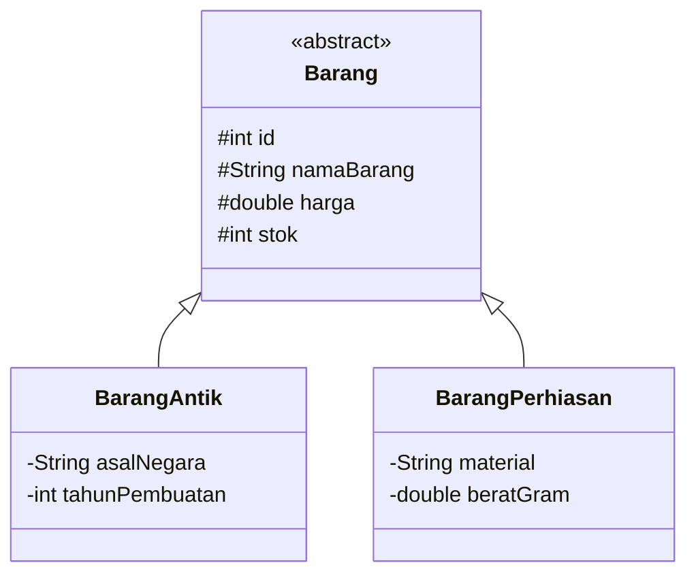

# Dokumentasi Program Mini Project 4 PBO

## Sistem Manajemen Inventaris Toko Barang Antik (Monarch Antiqu'e)

---

### Informasi Mahasiswa

* **Nama** : Mikhel Febian
* **NIM** : 2509116056
* **Kelas** : B
* **Angkatan** : 2025
* **Mata Kuliah** : Pemrograman Berorientasi Objek
* **Tema Program** : Sistem Manajemen Inventaris Barang Antik
* **Nama Sistem** : Monarch Antiqu'e System

---

## 1. Deskripsi Singkat Program

**Monarch Antiqu'e System** merupakan aplikasi manajemen inventaris barang antik berbasis **Command Line Interface (CLI)** yang dikembangkan menggunakan bahasa pemrograman Java.

Program digunakan untuk mengelola data barang antik dan perhiasan melalui operasi **Create, Read, Update, dan Delete (CRUD)**: menambah, menampilkan, mencari (berdasarkan ID atau kata kunci nama), memperbarui, dan menghapus data barang.

Pada **Mini Project 4**, program dikembangkan dari Mini Project 3 dengan perubahan utama:

* Penyimpanan data dipindahkan dari `ArrayList` di memori ke **database MySQL** (`tokoantik`).
* Seluruh akses database menggunakan **JDBC dengan `PreparedStatement`**.
* Akses data dipisahkan ke lapisan **DAO** (`BarangDao` dan `BarangDaoImpl`).
* **Dummy data awal diisi lewat file `.sql`**, bukan lewat kode Java, sehingga menu *Tampilkan Semua Barang* langsung menampilkan data tanpa input dari awal.
* Konsep OOP dari Mini Project 3 (Encapsulation, Inheritance, Polymorphism, Abstraction, Interface, dan MVC) tetap dipertahankan.

---

## 2. Spesifikasi Program

* **Bahasa Pemrograman** : Java
* **JDK** : JDK 17+ (memakai *pattern matching* `instanceof`)
* **IDE** : Apache NetBeans
* **Build Tool** : Maven
* **Database** : MySQL (nama database: `tokoantik`)
* **Koneksi** : JDBC (MySQL Connector/J) dengan `PreparedStatement`
* **Pola Akses Data** : DAO (Data Access Object)
* **Arsitektur** : Model-View-Controller (MVC)
* **Antarmuka** : Command Line Interface (CLI)

---

## 3. Struktur Package

```text
Minpro-4-PBO-ManajemenTokoAntik
├── database/
│   └── tokoantik.sql                    <- skema tabel + dummy data awal
├── src/main/java/com/mycompany/tokoantik
│   ├── config/
│   │   └── DatabaseConfig.java          <- koneksi JDBC
│   ├── controller/
│   │   └── BarangController.java
│   ├── dao/
│   │   ├── BarangDao.java               <- interface DAO
│   │   └── BarangDaoImpl.java           <- implementasi JDBC (PreparedStatement)
│   ├── model/
│   │   ├── Authenticable.java
│   │   ├── Barang.java
│   │   ├── BarangAntik.java
│   │   └── BarangPerhiasan.java
│   ├── util/
│   │   └── Validator.java
│   ├── view/
│   │   └── MainView.java
│   └── Main.java
├── pom.xml
└── README.md
```

### Fungsi setiap package

| Package / File   | Fungsi                                                                   |
| ---------------- | ------------------------------------------------------------------------ |
| `model`          | Class entitas (`Barang`, `BarangAntik`, `BarangPerhiasan`) dan interface `Authenticable` |
| `dao`            | Kontrak (`BarangDao`) dan implementasi JDBC (`BarangDaoImpl`) untuk seluruh query SQL |
| `config`         | `DatabaseConfig` yang menyediakan `Connection` ke database               |
| `controller`     | Menjembatani View dan DAO                                                |
| `view`           | Menu CLI dan interaksi dengan pengguna                                   |
| `util`           | `Validator` untuk validasi input pengguna                                |
| `database/*.sql` | Skema database dan dummy data awal                                       |
| `Main`           | Entry point program                                                      |

---

## 4. Alur Program

Saat program dijalankan, `Main` membuat objek `MainView` lalu memanggil `start()`. `MainView` membuat `BarangController`, dan seluruh operasi data diteruskan ke DAO hingga ke database.

```text
Main
  ↓
MainView           (menu & input CLI, validasi lewat Validator)
  ↓
BarangController   (penghubung View dan DAO)
  ↓
BarangDao  ←  BarangDaoImpl   (PreparedStatement)
  ↓
DatabaseConfig     (DriverManager.getConnection)
  ↓
MySQL: database tokoantik, tabel barang
```

Menu utama:

```text
1. Tambah Barang
2. Tampilkan Semua Barang
3. Cari Barang
4. Update Barang (Tekan Enter jika data tidak diubah)
5. Hapus Barang
6. Keluar
```

### 4.1 Tambah Barang
Pengguna memilih jenis (Barang Antik / Perhiasan), mengisi atribut umum (nama, harga, stok) dan atribut khusus. Controller membuat object `BarangAntik` atau `BarangPerhiasan`, lalu `BarangDaoImpl.create()` menjalankan `INSERT`. Kolom `id` dibuat otomatis oleh database (`AUTO_INCREMENT`).

### 4.2 Tampilkan Semua Barang
`BarangDaoImpl.getAll()` menjalankan `SELECT * FROM barang`, lalu setiap baris diubah menjadi object `BarangAntik` atau `BarangPerhiasan` sesuai kolom `jenis`. Hasil ditampilkan dalam tabel CLI. Data awal dari file `.sql` langsung tampil di menu ini.

### 4.3 Cari Barang
* Berdasarkan ID: `getById()` dengan `WHERE id = ?`.
* Berdasarkan nama/keyword: `getByKeyword()` dengan `WHERE LOWER(nama_barang) LIKE ?` (tidak membedakan huruf besar/kecil).

### 4.4 Update Barang
Pengguna memilih ID dari tabel. Data lama diambil dari database dan ditampilkan di prompt. Menekan `ENTER` mempertahankan nilai lama. Nilai baru diterapkan lewat setter (yang memvalidasi data), lalu `update()` menjalankan `UPDATE`.

### 4.5 Hapus Barang
Pengguna memilih ID, memberi konfirmasi `y/n`, lalu `delete()` menjalankan `DELETE`.

### 4.6 Keluar
Perulangan menu dihentikan dan program berakhir.

---

## 5. Penerapan Encapsulation

Atribut `Barang` dibuat `protected` dan hanya diubah lewat setter yang memvalidasi nilai. `id` dibuat `final` sehingga tidak dapat diubah setelah object dibuat.

```java
public abstract class Barang {
    protected final int id;
    protected String namaBarang;
    protected double harga;
    protected int stok;

    public void setHarga(double harga) {
        if (harga < 0) {
            throw new IllegalArgumentException("Harga tidak boleh negatif.");
        }
        this.harga = harga;
    }
    ...
}
```

Constructor juga memanggil setter (`setNamaBarang`, `setHarga`, `setStok`), sehingga aturan validasi berlaku saat object dibuat, termasuk saat object dibentuk dari data database. Pada subclass, atribut khusus bersifat `private`:

* `BarangAntik`: `asalNegara`, `tahunPembuatan`
* `BarangPerhiasan`: `material`, `beratGram` (`setBeratGram` menolak nilai ≤ 0)

---

## 6. Penerapan Inheritance

`Barang` adalah superclass, `BarangAntik` dan `BarangPerhiasan` adalah subclass.



```java
public class BarangAntik extends Barang implements Authenticable {
    public BarangAntik(int id, String namaBarang, double harga, int stok,
                       String asalNegara, int tahunPembuatan) {
        super(id, namaBarang, harga, stok);
        ...
    }
}
```

Subclass mewarisi atribut dan method umum (`getNamaBarang()`, `getHarga()`, `setStok()`, dan lainnya), serta memanggil constructor superclass dengan `super(...)`.

---

## 7. Penerapan Polymorphism dan Abstraction

### 7.1 Abstraction

`Barang` adalah **abstract class** yang tidak dapat diinstansiasi langsung, dengan dua **abstract method**:

```java
public abstract String getJenisBarang();
public abstract String getDetailAtribut();
```

Setiap subclass wajib mengimplementasikannya. Abstraction juga diterapkan pada lapisan data lewat **interface `BarangDao`** yang hanya mendefinisikan kontrak operasi, sedangkan `BarangDaoImpl` menentukan cara kerjanya dengan JDBC:

```java
public interface BarangDao {
    void create(Barang barang);
    ArrayList<Barang> getAll();
    Barang getById(int id);
    ArrayList<Barang> getByKeyword(String keyword);
    void update(Barang barang);
    void delete(int id);
}
```

### 7.2 Polymorphism — Overriding

`getJenisBarang()` dan `getDetailAtribut()` di-*override* berbeda oleh tiap subclass:

```java
// BarangAntik
@Override
public String getDetailAtribut() {
    return String.format("Asal: %-10s | Tahun: %-4d | Sertifikat: %s",
            asalNegara, tahunPembuatan, getKodeSertifikat());
}

// BarangPerhiasan
@Override
public String getDetailAtribut() {
    return String.format("Mat: %-10s | Berat: %.1fg | Sertifikat: %s",
            material, beratGram, getKodeSertifikat());
}
```

Hasil query disimpan dalam `ArrayList<Barang>` (tipe superclass). Saat `toString()` pada `Barang` memanggil `getJenisBarang()` dan `getDetailAtribut()`, Java otomatis memakai versi milik tipe object sebenarnya (*dynamic binding*). Method `mapResultSetToBarang()` di `BarangDaoImpl` mengembalikan `Barang` yang isinya `BarangAntik` atau `BarangPerhiasan` tergantung kolom `jenis`.

### 7.3 Polymorphism — Overloading

Pada `BarangController`, method `tambahBarang()` dan `cariBarang()` memiliki beberapa versi dengan parameter berbeda, yang dipanggil dari `MainView`:

```java
controller.tambahBarang(nama, harga, stok, asal, tahun);       // Barang Antik
controller.tambahBarang(nama, harga, stok, material, berat);   // Perhiasan

Barang b = controller.cariBarang(id);                          // cari by ID
ArrayList<Barang> hasil = controller.cariBarang(keyword);      // cari by keyword
```

---

## 8. Penerapan MVC dan DAO

| Lapisan    | File                                                         | Tanggung jawab                         |
| ---------- | ------------------------------------------------------------ | -------------------------------------- |
| Model      | `Barang`, `BarangAntik`, `BarangPerhiasan`, `Authenticable`  | Struktur data dan perilaku object      |
| View       | `MainView` (+ `Validator`)                                   | Menu, input, dan tampilan CLI          |
| Controller | `BarangController`                                           | Menghubungkan View dengan DAO          |
| DAO        | `BarangDao`, `BarangDaoImpl`                                 | Seluruh query SQL ke database          |

Tidak ada query SQL di `MainView` maupun `BarangController`; seluruhnya berada di `BarangDaoImpl`.

---

## 9. Penerapan JDBC

### 9.1 Database dan File `.sql`

File **`database/tokoantik.sql`** ada di repository ini dan berisi pembuatan database, tabel, serta **dummy data awal**. Data awal diisi lewat file `.sql`, **tidak diisi lewat kode Java**.

Struktur tabel `barang` (sesuai kolom yang dipakai `BarangDaoImpl`):

| Kolom             | Keterangan                                              |
| ----------------- | ------------------------------------------------------- |
| `id`              | Primary key, `AUTO_INCREMENT`                           |
| `nama_barang`     | Nama barang                                             |
| `harga`           | Harga barang                                            |
| `stok`            | Jumlah stok                                             |
| `jenis`           | `Antik` atau `Perhiasan`                                |
| `asal_negara`     | Khusus Barang Antik (`NULL` untuk perhiasan)            |
| `tahun_pembuatan` | Khusus Barang Antik (`NULL` untuk perhiasan)            |
| `material`        | Khusus Perhiasan (`NULL` untuk barang antik)            |
| `berat_gram`      | Khusus Perhiasan (`NULL` untuk barang antik)            |

Cara import:

```bash
mysql -u root -p < database/tokoantik.sql
```

atau lewat phpMyAdmin / MySQL Workbench (menu *Import*).

### 9.2 Koneksi Database

`DatabaseConfig` menyediakan koneksi JDBC:

```java
public class DatabaseConfig {
    private static final String URL = "jdbc:mysql://localhost:3306/tokoantik";
    private static final String USER = "root";
    private static final String PASSWORD = "";

    public static Connection getConnection() throws SQLException {
        return DriverManager.getConnection(URL, USER, PASSWORD);
    }
}
```

MySQL Connector/J ditambahkan sebagai dependency pada `pom.xml`.

### 9.3 Prepared Statement

Seluruh query memakai `PreparedStatement` dengan parameter `?`, sehingga nilai dikirim terpisah dari perintah SQL dan aman dari SQL Injection. `Connection`, `PreparedStatement`, dan `ResultSet` dibuka dengan **try-with-resources** agar otomatis ditutup.

```java
// CREATE
String sql = "INSERT INTO barang (nama_barang, harga, stok, jenis, asal_negara, "
           + "tahun_pembuatan, material, berat_gram) VALUES (?, ?, ?, ?, ?, ?, ?, ?)";
try (Connection conn = DatabaseConfig.getConnection();
     PreparedStatement stmt = conn.prepareStatement(sql)) {

    stmt.setString(1, barang.getNamaBarang());
    stmt.setDouble(2, barang.getHarga());
    stmt.setInt(3, barang.getStok());

    if (barang instanceof BarangAntik ba) {
        stmt.setString(4, "Antik");
        stmt.setString(5, ba.getAsalNegara());
        stmt.setInt(6, ba.getTahunPembuatan());
        stmt.setNull(7, Types.VARCHAR);
        stmt.setNull(8, Types.DOUBLE);
    } else if (barang instanceof BarangPerhiasan bp) {
        stmt.setString(4, "Perhiasan");
        stmt.setNull(5, Types.VARCHAR);
        stmt.setNull(6, Types.INTEGER);
        stmt.setString(7, bp.getMaterial());
        stmt.setDouble(8, bp.getBeratGram());
    }
    stmt.executeUpdate();
}
```

| Operasi | Method DAO         | Query                                                 |
| ------- | ------------------ | ----------------------------------------------------- |
| Create  | `create(Barang)`   | `INSERT INTO barang (...) VALUES (?, ?, ...)`         |
| Read    | `getAll()`         | `SELECT * FROM barang`                                |
| Read    | `getById(int)`     | `SELECT * FROM barang WHERE id = ?`                   |
| Search  | `getByKeyword(String)` | `SELECT * FROM barang WHERE LOWER(nama_barang) LIKE ?` |
| Update  | `update(Barang)`   | `UPDATE barang SET ... WHERE id = ?`                  |
| Delete  | `delete(int)`      | `DELETE FROM barang WHERE id = ?`                     |

### 9.4 Pemetaan Hasil Query ke Object

`ResultSet` diubah menjadi object oleh `mapResultSetToBarang()`:

```java
private Barang mapResultSetToBarang(ResultSet rs) throws SQLException {
    ...
    String jenis = rs.getString("jenis");
    if ("Antik".equalsIgnoreCase(jenis)) {
        return new BarangAntik(id, nama, harga, stok, asal, tahun);
    } else {
        return new BarangPerhiasan(id, nama, harga, stok, material, berat);
    }
}
```

---

## 10. Penerapan Interface (Fitur Tambahan)

Interface `Authenticable` dari Mini Project 3 tetap digunakan oleh `BarangAntik` dan `BarangPerhiasan`.

```java
public interface Authenticable {
    final String SERTIFIKAT_PREFIX = "CERT-MONARCH-";

    String getKodeSertifikat();
    boolean verifikasiKeaslian();
}
```

| Class             | `getKodeSertifikat()`                | `verifikasiKeaslian()`   |
| ----------------- | ------------------------------------ | ------------------------ |
| `BarangAntik`     | `CERT-MONARCH-ANT-<id>`              | `tahunPembuatan < 1950`  |
| `BarangPerhiasan` | `CERT-MONARCH-JWL-<id>`              | `beratGram > 0.5`        |

> Catatan: Mini Project 4 ini **tidak menerapkan framework ORM**; akses database dilakukan langsung dengan JDBC dan DAO.

---

## 11. Validasi dan Exception Handling

* **`Validator`** (package `util`) memvalidasi seluruh input CLI: angka bulat, angka desimal, nilai minimum, string tidak kosong, rentang pilihan menu, serta versi *optional* (tekan `ENTER` untuk mempertahankan nilai lama). Kesalahan input ditangani dengan `try-catch NumberFormatException` dan *re-prompt*.
* **Model** melempar `IllegalArgumentException` untuk data tidak valid (nama kosong, harga/stok negatif, berat ≤ 0, dan seterusnya).
* **DAO** menangkap `SQLException` pada setiap method dan menampilkan pesan kesalahan, misalnya `Gagal menambahkan barang: ...`, sehingga program tidak berhenti saat database bermasalah.

---

## 12. Dokumentasi Output Program

Berikut merupakan dokumentasi output program berdasarkan setiap menu yang tersedia pada **Monarch Antiqu'e System**.

### 12.1 Menu Utama

Menampilkan menu utama program yang terdiri dari fitur tambah, tampilkan, cari, update, hapus, dan keluar.


**Spesifikasi Teknis & Mekanisme Pengolahan:**
* **Input Control:** Sistem menerima masukan integer pada prompt `Pilih menu (1-6):`.
* **Input Validation & Exception Handling:** 
  * Jika input berada di luar jangkauan angka `1-6` atau berupa karakter non-numerik, sistem akan memicu error handling/pesan peringatan dan melakukan *re-prompt* tanpa menghentikan program.
* **Control Flow:** Pilihan angka dipetakan menggunakan struktur percabangan (`switch-case`) untuk memanggil masing-masing sub-fungsi/prosedur yang sesuai.
* **Screen Refresh:** Setiap kali kembali ke Menu Utama, layar terminal dapat dibersihkan (`cls` / `clear`) untuk menjaga kebersihan antarmuka CLI.
  
---

### 12.2 Tambah Barang

Menu ini digunakan untuk menambahkan barang baru. Program menyediakan dua jenis barang, yaitu **Barang Antik** dan **Perhiasan**.

#### Tambah Barang Antik


Sub-menu **Tambah Barang Antik** menangani alur masukan data secara berurutan untuk mencatat item baru ke dalam memori sistem. Proses diawali dengan percabangan opsi jenis barang (`1` untuk Barang Antik Umum dan `2` untuk Barang Perhiasan) yang menentukan skema instansiasi objek. Setelah tipe barang dipilih, program mengeksekusi instruksi input linier untuk membaca masukan string pada atribut nama barang dan asal negara, serta melakukan *parsing* numerik pada harga, stok, dan tahun pembuatan. Setiap variabel yang diinputkan akan divalidasi tipe datanya sebelum dimasukkan ke dalam *array* atau struktur data utama. Jika seluruh nilai atribut valid dan operasi penambahan data ke dalam sistem berhasil, program akan mencetak pesan konfirmasi `-> Data barang berhasil ditambahkan!` sebagai penanda akhir eksekusi fungsi.

#### Tambah Barang Perhiasan


Sub-menu **Tambah Barang Perhiasan** bertugas menangani pencatatan item perhiasan ke dalam sistem melalui pemetaan atribut khusus. Ketika pengguna memilih opsi jenis barang `2` pada menu awal, program mengarahkan alur eksekusi untuk menginstansiasi objek khusus perhiasan. Selanjutnya, sistem secara sekuensial meminta masukan input teks untuk nama barang dan material, serta melakukan *parsing* data numerik untuk harga, stok barang, dan berat dalam satuan gram. Seluruh nilai variabel ini divalidasi dan disimpan ke dalam struktur data utama sistem. Setelah semua atribut berhasil dialokasikan, program memberikan respon umpan balik berupa pesan `-> Data barang berhasil ditambahkan!` sebagai penanda bahwa proses penyimpanan data perhiasan telah selesai dilakukan.

---

### 12.3 Tampilkan Semua Barang

Menampilkan seluruh barang yang tersimpan dalam sistem beserta informasi seperti ID, nama, jenis, harga, stok, dan atribut khusus barang.


Menu **Tampilkan Semua Barang** menangani proses pemanggilan dan penyajian seluruh koleksi data yang tersimpan di dalam memori sistem ke dalam bentuk tabel tabular CLI. Ketika pengguna memilih opsi `2`, program akan melakukan *traversal* atau iterasi terhadap seluruh objek inventaris dan memformat datanya agar sejajar secara rapi. Setiap baris data menampilkan atribut umum seperti ID, Nama Barang, Jenis, Harga, dan Stok, serta atribut spesifik berdasarkan kelas barang pada kolom Detail & Sertifikat Keaslian. Untuk kategori *Barang Antik*, sistem menampilkan rincian Asal Negara, Tahun Pembuatan, dan Nomor Sertifikat. Sedangkan untuk kategori *Perhiasan*, sistem secara dinamis menyajikan informasi Material (Mat), Berat dalam gram, dan Nomor Sertifikat.

---

### 12.4 Cari Barang

Menu **Cari Barang** bertugas menangani pencarian data inventaris berdasarkan metode pencarian yang dipilih oleh pengguna. Saat menu ini dipanggil, sistem menyediakan dua skema pencarian, yaitu pencarian berdasarkan ID (`1`) dan pencarian berdasarkan kata kunci nama (`2`). 

#### Cari Berdasarkan ID


Pada metode pencarian berdasarkan ID, program melakukan *exact matching* atau pencarian presisi pada kunci utama (ID) objek.

#### Cari Berdasarkan Nama


Sedangkan pada metode pencarian berdasarkan nama, program menjalankan pencarian kata kunci (*keyword matching*) yang memeriksa kecocokan string nama barang. Jika data yang dicari ditemukan di dalam sistem, program langsung menampilkan rincian barang tersebut lengkap dengan atribut khusus sesuai jenis kategorinya.

---

### 12.5 Update Barang

Menu **Update Barang** bertugas menangani pembaruan data inventaris yang telah tersimpan berdasarkan ID barang yang dipilih. Saat menu dijalankan, sistem terlebih dahulu menampilkan tabel daftar barang sebagai acuan navigasi pengguna. Setelah pengguna memasukkan ID target, program akan memuat nilai lama (*existing value*) untuk setiap atribut dan memberikan petunjuk pembaruan. Sistem menerapkan mekanisme penanganan input kondisional, di mana jika pengguna menekan tombol `ENTER` tanpa memasukkan teks, nilai lama barang akan tetap dipertahankan. Apabila pengguna mengetikkan input baru, sistem akan melakukan *parsing* serta pembaruan nilai atribut terkait dalam memori. Proses diakhiri dengan respon pesan konfirmasi `-> Barang berhasil diupdate.` sebagai penanda suksesnya pembaruan data.


---

### 12.6 Hapus Barang

Menu **Hapus Barang** bertugas menangani penghapusan entitas data dari struktur data memori berdasarkan ID barang yang ditentukan pengguna. Saat menu diakses, program terlebih dahulu menyajikan tabel daftar barang sebagai referensi visual ID. Sistem dilengkapi dengan mekanisme penanganan kesalahan input (*input error handling*); jika masukan ID bukan berupa angka bulat atau tidak valid, program akan memicu pesan peringatan `-> Input tidak valid! Harap masukkan angka bulat.` dan melakukan *re-prompt* hingga input yang sesuai diberikan. Setelah ID valid diterima, program menjalankan perintah konfirmasi dua arah (`y/n`) untuk memastikan keamanan data. Jika pengguna mengonfirmasi dengan memilih `y`, elemen barang terkait akan dihapus dari daftar dan sistem mengembalikan pesan respon `-> Barang berhasil dihapus.`.


---

### 12.7 Keluar Program

Menu **Keluar Program** bertugas menghentikan seluruh eksekusi aplikasi dan memutus perulangan utama (*main loop*) sistem. Saat pengguna memilih opsi `6` pada prompt menu utama, program mengeksekusi perintah terminasi yang mencetak pesan penutup `Terima kasih telah menggunakan Monarch Antiqu'e System!` sebelum mengembalikan status kode keluar secara aman.


## 13. Cara Menjalankan Program

1. Install JDK 17+, MySQL, dan Apache NetBeans.
2. Import `database/tokoantik.sql` ke MySQL.
3. Sesuaikan `URL`, `USER`, dan `PASSWORD` di `DatabaseConfig.java` jika berbeda.
4. Buka project di NetBeans, lakukan *Clean and Build* agar dependency Maven terunduh.
5. Jalankan `Main.java`.

---

## 14. Kesimpulan

Pada Mini Project 4, Monarch Antiqu'e System berkembang dari penyimpanan `ArrayList` menjadi sistem yang terhubung ke database MySQL menggunakan **JDBC (`PreparedStatement`)** dan **DAO**, dengan data awal dari file **`.sql`**. Konsep **Encapsulation, Inheritance, Polymorphism, Abstraction, Interface, dan MVC** tetap diterapkan langsung pada program.
